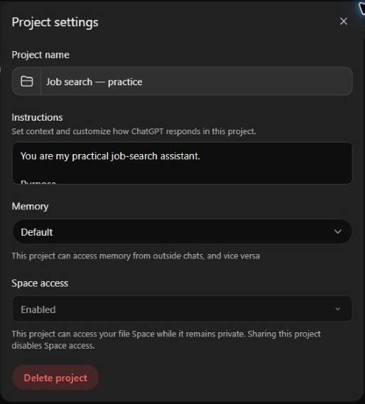
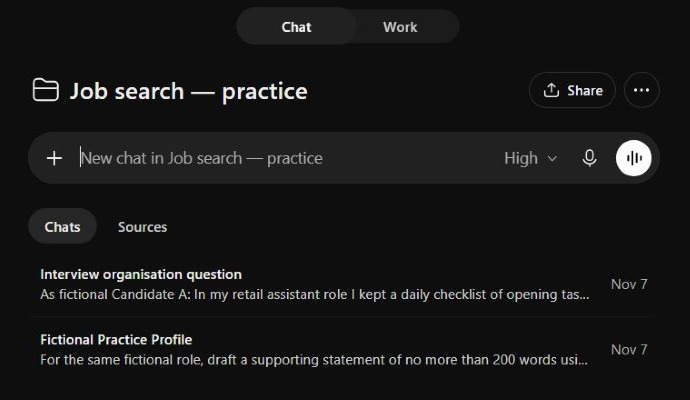
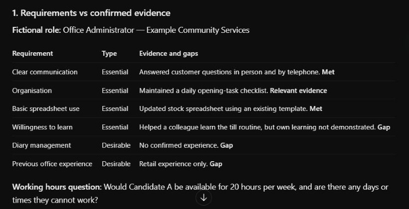
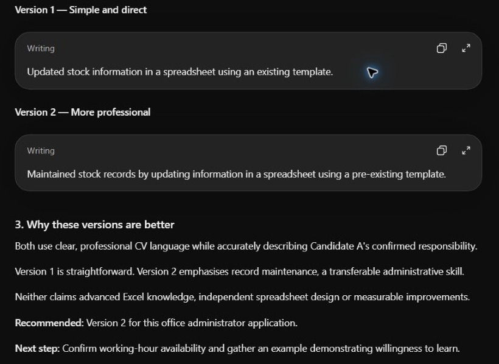
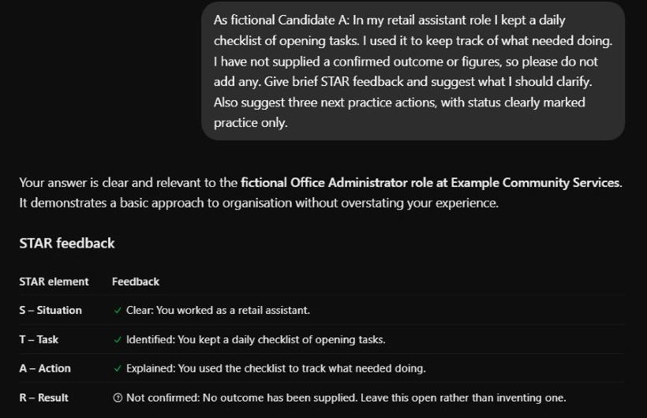

# A job search, one step at a time

[Back to the guide](../README.md)

This walkthrough uses a fictional candidate and fictional vacancy. It shows how AI can help organise and express experience. It does not represent a real job opportunity or guarantee an interview.

## 1. Start safely

Read the [privacy notes](privacy-notes.md). For your first attempt, use the fictional text below rather than your own CV.

Create a ChatGPT Project called **Job search — practice**. If your screen offers **Chat** and **Work**, select **Chat** for these exercises.

Open the Project's **…** menu, choose **Project settings**, paste the [Project instructions](project-instructions.md) into **Instructions**, then select **Save**. Reopen settings to check they are there. Labels may change between versions.

Start your task chats inside that Project. Paste a complete prompt into the message box, check it, then press **Send**. Use **Shift + Enter** if you need to type a line break.

For a demonstration, explicitly ask ChatGPT to use only the fictional pack and avoid personal memories or connected sources. Check the output before sharing it. This is an instruction, not a technical privacy barrier.



*ChatGPT in Chrome, 7 November 2026. The instructions field shows only the beginning of the saved text; paste the full instructions.*

Projects bring related chats, sources and instructions together; see [OpenAI's Projects guide](https://learn.chatgpt.com/docs/projects) (checked 7 November 2026). Menus and availability may vary. If you cannot access Projects, use an ordinary chat and paste the relevant instructions and example text for the task.



*ChatGPT in Chrome, 7 November 2026. Two chats were used in this trial: one for the profile and application tasks, and one for interview practice.*

## 2. Supply a small, fictional evidence pack

Copy this into your first chat or save it as a text file to add as a Project source:

```text
FICTIONAL PRACTICE PROFILE — Candidate A
Goal: explore an entry-level office administrator role.
Experience: two years as a retail assistant at a fictional shop.
Confirmed tasks:
- Answered customer questions in person and by telephone.
- Updated a stock spreadsheet using an existing template.
- Helped a new colleague learn the till routine.
- Kept a daily checklist of opening tasks.
Skills to develop: writing formal business emails.
Not confirmed: advanced Excel, diary management or office qualifications.
No figures for sales improvements or time saved have been provided.
```

Then supply this fictional advert:

```text
FICTIONAL VACANCY — Office Administrator, Example Community Services
Hours: 20 hours a week; exact working pattern to be discussed.
Essential: clear communication, organisation, basic spreadsheet use,
and willingness to learn.
Desirable: diary management and previous office experience.
Application: a short CV and a supporting statement of up to 200 words.
This is a practice advert only. There is no application link or deadline.
```

Ask: “Summarise the profile and advert separately. Which details are missing? Use only the material above.”

**Check:** the summary should not add qualifications, advanced spreadsheet skills or a real employer.

## 3. Understand the match

Start a chat called **Understanding the advert**. If you pasted the pack into your first chat rather than adding it as a Project source, paste the pack into this new chat too. Naming an earlier chat does not guarantee its content is available. Alternatively, continue in the first chat for your initial try.

> Compare the essential and desirable requirements with Candidate A's confirmed evidence. Show a table of requirement, evidence and gap. Suggest one question to clarify the working pattern.

Communication might be supported by answering customer questions. Diary management should remain a gap. Basic spreadsheet experience does not establish advanced Excel ability.

**Useful outcome:** a clearer view of strengths and questions, rather than a claim that the candidate meets everything.



*Example response from ChatGPT in Chrome, 7 November 2026. Results will vary. “Met” is the AI's interpretation of the limited example, not a hiring decision. The hours question shown asks about candidate availability; also ask the employer which days the hours cover.*

## 4. Improve one CV bullet

In **CV work**, ask:

> Improve “Updated a stock spreadsheet using an existing template” for this role. Offer two clear versions using only confirmed facts. Explain what you changed. Do not invent numbers or software expertise.

A grounded version could be: “Kept stock information up to date using an existing spreadsheet template.”

**Check:** reject additions such as “advanced Excel”, “managed stock strategy” or “reduced errors by 30%” unless the candidate can genuinely evidence them.



*ChatGPT in Chrome, 7 November 2026. Neither version adds advanced Excel skills or invented results.*

## 5. Draft a supporting statement

> Draft a supporting statement of no more than 200 words for the fictional vacancy, using only Candidate A's confirmed evidence. Keep it natural and in UK English. Acknowledge relevant learning needs honestly. Include a separate checklist of facts to review outside the statement.

Read it aloud. Remove anything the candidate could not explain in an interview. Check the word count and the advert's requirements yourself.

For a real application, follow the employer's rules on AI assistance, check the vacancy is current and add contact details only in your own final document where needed.

## 6. Prepare a recruiter question

In **Recruiter messages**, ask:

> Draft a brief message asking what days the 20 weekly hours would cover and whether training is provided. Use placeholders for names. Prepare a draft only.

Review it before sending anything yourself. This fictional demo has no recruiter to contact.

## 7. Practise an interview answer

In **Interview practice**, ask:

> Ask Candidate A one interview question about organisation. Wait for my answer. Then help me structure it using Situation, Task, Action and Result without inventing details.

Try answering using the daily opening checklist. If you do not know the result, say so; a qualitative result is useful only if it is true.



*ChatGPT in Chrome, 7 November 2026. The response leaves the missing outcome open rather than inventing one.*

## 8. Record the next step

Keep a simple record of real applications outside the public demo:

| Role | Deadline | Status | Next action |
| --- | --- | --- | --- |
| Fictional office administrator | Not applicable | Practice only | Review the statement |

For real roles, distinguish **considering**, **drafting**, **submitted** and **interview arranged**. Only change the status when it has actually happened.

## 9. Optional: add a daily Job Sweep

Once you are comfortable with the exercises, try a separate chat called **Job Sweep** in your job-search Project. Define the roles, area, hours and salary you want, then test a search for accessible online adverts. Where scheduled tasks are available, ask it to repeat each morning and return potential matches for you to check.

The [Job Sweep guide](job-sweep.md) has the filters, full prompts, an 08:00 Europe/London schedule and notification checks. Notifications depend on your account and device settings. It also explains missing salary details, duplicate results and inaccessible adverts. This is an additional educational example; the fictional practice run below did not test scheduled searches or notifications.

## 10. Optional: refresh your LinkedIn profile

If you have a LinkedIn profile, use a **LinkedIn profile refresh** chat to bring it up to date alongside your CV. The [LinkedIn guide](linkedin-profile.md) covers the headline, About section, experience, skills and other useful details, with prompts that use only your checked evidence.

Start with its sharing-controls checklist before saving edits. Switching off network announcements does not make profile changes invisible to an employer. This optional writing exercise was not part of the earlier fictional practice run; no real profile was edited.

## Before using anything for real

- Check every fact, date, skill and achievement.
- Verify employer details and application instructions from the original source.
- Remove invented claims and replace vague wording with real examples.
- Keep private information out of public chats, screenshots and this repository.
- Save your own final copy and decide what to submit yourself.

## Try it with the Circle

Ask: “Which was most useful: understanding the advert, improving a CV bullet or practising an interview?” Members can share what they learnt without sharing CVs or personal circumstances.

## What we learnt from trying it

The example was tried in ChatGPT in Chrome on 7 November 2026. Profile review, role matching, CV wording, a supporting statement and a recruiter draft were explored in one chat; interview practice used a separate chat with the fictional pack pasted again. The steps were grouped for this trial, so these screenshots illustrate outcomes rather than an exact prompt-by-prompt recording.

- CV suggestions retained the spreadsheet-template limitation and avoided invented figures.
- Interview practice asked one question, waited, and left the missing result unconfirmed.
- The draft recruiter message asked about working days and training.
- A later suggestion proposed using “helped a colleague learn” for a willingness-to-learn question. That describes supporting someone else's learning; it does not by itself show the candidate's own willingness to learn. Challenge suggestions that make this sort of leap.
- The comparison's hours question focused on candidate availability. Ask the employer about the actual working pattern too.

This trial checks the fictional exercises, not real vacancies, file-upload behaviour, every account setting or whether a new user can complete the guide unaided. Responses vary; review yours rather than expecting identical wording.

[More prompts](example-chats.md) · [Screenshot gallery](../images/README.md)
