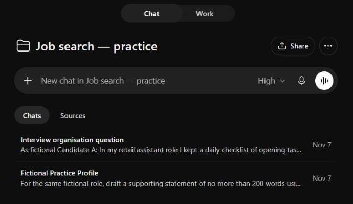
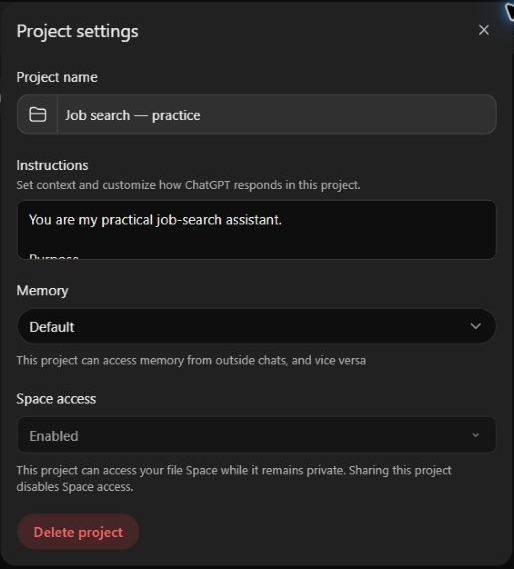
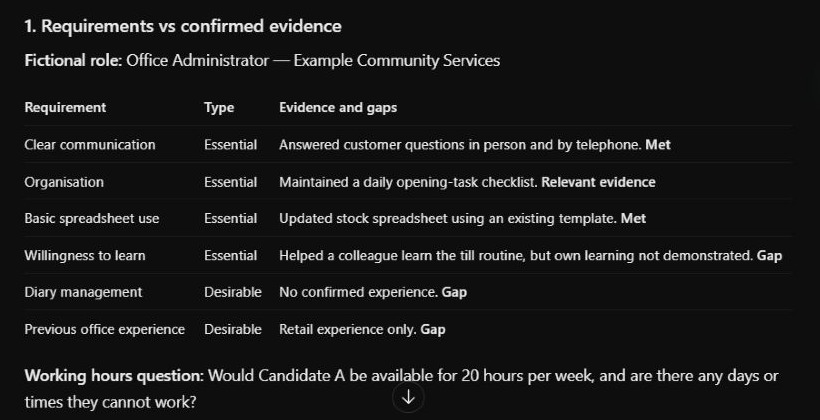
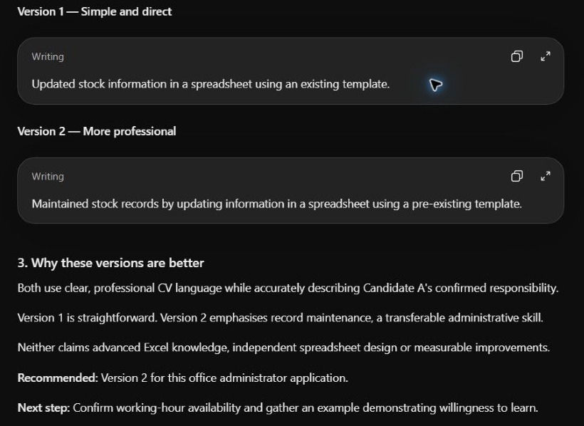
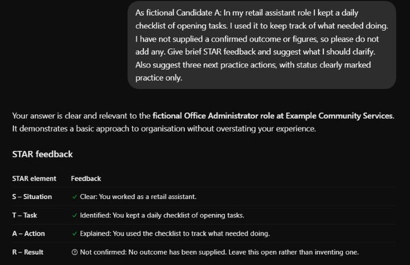

# Demo screenshots

[Back to the guide](../README.md) · [Privacy notes](../docs/privacy-notes.md)

These five screenshots were captured from a fictional practice Project in ChatGPT using Chrome on 7 November 2026. They were cropped to remove unrelated navigation and account details. Outputs and screens may differ for other accounts.

## Practice Project

Two chats were used: profile and application tasks together, with interview practice separately.

## Project settings

The field shows only the beginning of the instructions. Paste the full text from the [instructions guide](../docs/project-instructions.md). Memory and access labels shown here describe this demonstration account; review your own settings before using personal material.

## Comparing evidence

“Met” is an AI interpretation of the fictional evidence, not a recruitment assessment. The hours question focuses on candidate availability; ask the employer which days the hours cover as well.

## CV wording

The suggested versions retain use of an existing template and add no advanced Excel claims.

## Interview feedback

The candidate's example has no confirmed outcome, and the feedback leaves that gap open.

## Adding future screenshots

Use only fictional content from the [walkthrough](../docs/job-search-workflow.md). Keep unredacted originals outside the repository. Check account menus, sidebars, tabs, notifications, filenames and links before uploading.

Use readable PNG or JPEG images with numbered descriptive names. Add meaningful alternative text and a capture-date caption when embedding them. Keep essential instructions in text so the guide works without images.

The `screenshots/.gitkeep` file is a harmless remnant of the original empty folder.
